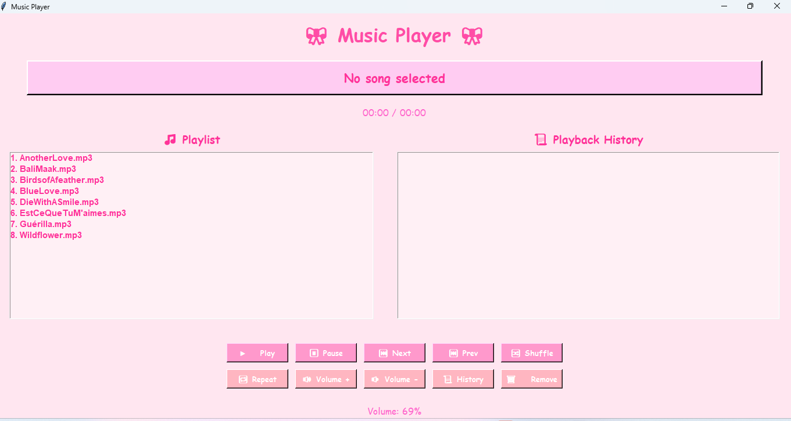

# 🎀 Music Player

A desktop MP3 player built with **Python**, **Tkinter** and **pygame**. The playlist is stored in a hand-written **doubly linked list**, so moving to the next or previous song is just following a pointer.



## Features

- Play, pause/resume, next and previous
- Shuffle and repeat (the buttons stay pressed while active)
- Click any song in the playlist to play it
- Playback history panel, plus a history popup
- Remove songs from the playlist
- Volume control
- Elapsed / total time display
- Auto-advances to the next song when one finishes

## Getting started

1. **Install Python 3.9+** (Tkinter comes with the standard installer on Windows and macOS; on some Linux distros install `python3-tk`).
2. **Install dependencies**
   ```bash
   pip install -r requirements.txt
   ```
3. **Add your music**: put `.mp3` files in the `music/` folder.
4. **Run it**
   ```bash
   python music_player.py
   ```

## How it works

| Part | What it does |
|------|--------------|
| `Node` | One song: title, file path, and `next` / `prev` pointers |
| `Playlist` | The doubly linked list: add, remove, next/previous with wrap-around |
| `MusicPlayer` | The Tkinter UI and pygame playback, wired to the playlist |

Song-end detection uses pygame's `set_endevent`, polled by Tkinter's `after()` loop, so the UI never blocks.

## Ideas for the future

- Add songs from inside the app (file dialog)
- Seek bar
- Support for other formats (WAV, OGG, FLAC)
- Save and load playlists

## License

MIT, see [LICENSE](LICENSE). 
